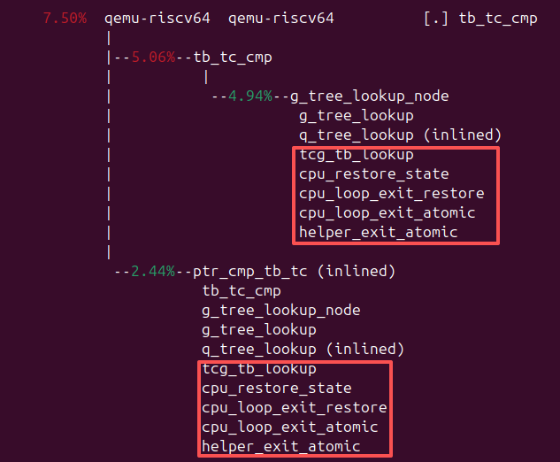
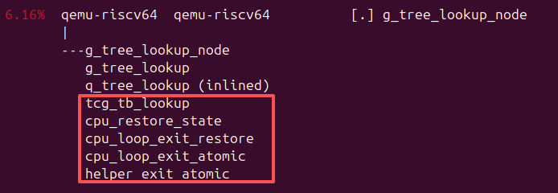
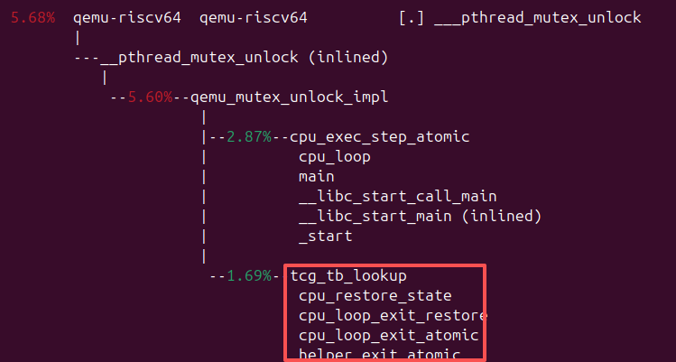

## payload

先用自己写的一个基于perf的小工具跑了一些payload，如下表所示：

| 负载            | 第 1 名       | 第 2 名               | 第 3 名               | 第 4 名            | 第 5 名              |
| ------------- | ----------- | ------------------- | ------------------- | ---------------- | ------------------ |
| `which`       | `cc1` 34.6% | `lto1` 21.0%        | `lto1-ltrans` 19.6% | `rpmbuild` 12.8% | `as` 2.4%          |
| `xz`          | `cc1` 53.2% | `rpmbuild` 12.1%    | `bash` 11.6%        | `xz` 4.9%        | `lto1-ltrans` 4.5% |
| `zlib-ng`     | `cc1` 51.2% | `lto1-ltrans` 22.0% | `lto1` 18.5%        | `as` 2.4%        | `cmake` 2.0%       |
| `file`        | `cc1` 19.4% | `m4` 16.3%          | `aclocal` 12.2%     | `lto1` 9.9%      | `autom4te` 8.5%    |
| `lz4`         | `cc1` 70.7% | `lz4` 28.4%         | `as` 0.3%           | `rpmbuild` 0.1%  | `ld` 0.1%          |
| `pcre2`       | `cc1` 48.5% | `rpmbuild` 16.3%    | `lto1-ltrans` 11.7% | `bash` 4.4%      | `m4` 3.5%          |
| `QEMU`（阶段性数据） | `cc1` 61.6% | `lto1-ltrans` 29.8% | `as` 4.3%           | `lto1` 2.1%      | `python3` 0.7%     |

QEMU这里，由于是我本机做构建的，耗时非常长，这里主要是包括以下内容：
- `qemu-system-*`：各架构的系统模拟器；
- 动态链接的 `qemu-*`：各架构的 linux-user 模拟器；
- `qemu-img`、`qemu-io`、`qemu-nbd` 等工具；
- QEMU 模块、共享库和 guest agent；
- LTO链接
因此虽然是阶段性数据，但是目前统计到的数据是整个QEMU构建中负载最重的部分。最明显的结论就是cc1这个工具调用，这个工具是gcc的后端。


## symbol

除了高频工具，还统计了不同负载下的高频符号调用：
### `which`
1. `___pthread_mutex_unlock`：7.9%
2. `helper_riscv_invalidate_reservations`：5.8%
3. `tb_tc_cmp`：5.5%
4. `liveness_pass_1`：4.9%
5. `g_tree_lookup_node`：4.4%
6. `helper_lookup_tb_ptr`：3.8%
7. `cpu_exec_loop`：3.2%
8. `cpu_exec`：2.9%

### `xz`
1. `___pthread_mutex_unlock`：9.5%
2. `tb_tc_cmp`：6.0%
3. `helper_riscv_invalidate_reservations`：5.3%
4. `g_tree_lookup_node`：4.6%
5. `liveness_pass_1`：4.4%
6. `cpu_exec`：3.5%
7. `helper_lookup_tb_ptr`：3.4%
8. `cpu_exec_loop`：3.2%

### `zlib-ng`
1. `___pthread_mutex_unlock`：12.9%
2. `tb_tc_cmp`：8.9%
3. `g_tree_lookup_node`：6.9%
4. `helper_riscv_invalidate_reservations`：5.5%
5. `cpu_exec`：4.8%
6. `cpu_exec_loop`：3.9%
7. `cpu_exec_end`：3.8%
8. `___pthread_mutex_lock`：3.3%

### `file`
1. `helper_riscv_invalidate_reservations`：7.7%
2. `helper_lookup_tb_ptr`：6.6%
3. `___pthread_mutex_unlock`：5.4%
4. `tb_tc_cmp`：4.7%
5. `liveness_pass_1`：4.6%
6. `cpu_restore_state_from_tb`：4.4%
7. `g_tree_lookup_node`：3.7%
8. `cpu_exec_end`：3.0%

### `lz4`
1. `___pthread_mutex_unlock`：11.8%
2. `tb_tc_cmp`：7.1%
3. `__pthread_cond_wait`：6.4%
4. `g_tree_lookup_node`：5.4%
5. `helper_riscv_invalidate_reservations`：5.0%
6. `cpu_exec`：4.1%
7. `cpu_exec_end`：3.8%
8. `cpu_exec_loop`：3.3%

### `pcre2`
1. `helper_riscv_invalidate_reservations`：8.6%
2. `helper_lookup_tb_ptr`：7.8%
3. `riscv_get_tb_cpu_state`：4.2%
4. `___pthread_mutex_unlock`：4.0%
5. `tb_tc_cmp`：3.6%
6. `liveness_pass_1`：3.1%
7. `g_tree_lookup_node`：3.0%
8. `__pthread_cond_wait`：2.8%

### QEMU 
1. `___pthread_mutex_unlock`：10.0%
2. `tb_tc_cmp`：9.1%
3. `g_tree_lookup_node`：8.9%
4. `helper_riscv_invalidate_reservations`：5.0%
5. `cpu_exec`：4.0%
6. `qht_lookup_custom`：3.7%
7. `cpu_exec_loop`：3.6%
8. `___pthread_mutex_lock`：3.3%


他们都出现了以下符号的高频调用：
- `___pthread_mutex_unlock`
- `tb_tc_cmp`
- `g_tree_lookup_node` 
- `helper_riscv_invalidate_reservations`

## 隔离cc1

下一步，就是针对cc1做分析，看cc1在user mode下都经过了QEMU中的哪些上下文。在执行时，和构建过程中的环境设置尽量保持一致：
- 使用相同的 `qemu-riscv64`；
- 使用相同的 RISC-V 构建根目录和动态库环境；
- 使用相同版本的 guest `cc1`；
- 使用相同的 GCC 内部头文件和系统头文件路径；
- 使用相同的目标架构 `-march=rva23u64`；
- 使用相同的 ABI `-mabi=lp64d`；
- 使用相同的优化级别 `-O2`；
- 使用 `-fno-omit-frame-pointer`；
- 使用构建环境中的 `LC_ALL=C.UTF-8`；
- 保留 `_REENTRANT` 宏定义。

整个编译耗时大约13秒。
命令如下：
```bash
LC_ALL=C.UTF-8 \
qemu/build-static/qemu-riscv64 \
  -L /var/tmp/build-root/riscv64-riscv64/.mount \
  /var/tmp/build-root/riscv64-riscv64/.mount/usr/lib64/gcc/riscv64-openruyi-linux/16/cc1 \
  -quiet \
  -isystem /var/tmp/build-root/riscv64-riscv64/.mount/usr/lib64/gcc/riscv64-openruyi-linux/16/include \
  -isystem /var/tmp/build-root/riscv64-riscv64/.mount/usr/lib64/gcc/riscv64-openruyi-linux/16/include-fixed \
  -isystem /var/tmp/build-root/riscv64-riscv64/.mount/usr/include \
  -D_REENTRANT \
  research/user-mode-perf/probe.c \
  -march=rva23u64 \
  -mabi=lp64d \
  -O2 \
  -fno-omit-frame-pointer \
  -o /tmp/quprof-cc1-C.UTF-8-1.s
```

之后就会去用perf看一下高频符号：
```
perf report \
  --stdio \
  --no-children \
  --percent-limit 1 \
  -i /tmp/cc1-callgraph.data
```

得到了如下的高频符号：
- `cpu_restore_state_from_tb`：**9.01%**
- `helper_riscv_invalidate_reservations`：**7.81%**
- `tb_tc_cmp`：**7.50%**
- `g_tree_lookup_node`：**6.16%**
- `___pthread_mutex_unlock`：**5.68%**
- `cpu_exec_end`：**4.71%**

前面我们用自己的工具采样了不同负载下出现的高频符号调用是：
- `___pthread_mutex_unlock`
- `tb_tc_cmp`
- `g_tree_lookup_node` 
- `helper_riscv_invalidate_reservations`

可以发现，他们都出现在了上面所列举的6个高频符号中。并且，进一步查看perf的调用图，我们可以发现，这几个高频符号都共享了一个高频的调用路径：
```
xxx_symbol
tcg_tb_lookup
cpu_restore_state
cpu_loop_exit_restore
cpu_loop_exit_atomic
helper_exit_atomic
```

具体可以查看如下截图：







## 上游讨论

做了上述事情后，我去邮件列表看一下最近的讨论有没有关于性能方面的，结果真的有：

邮件列表中，Rick 报告该正确性补丁引入了严重的性能回退。补丁在进入并行执行状态后，会让每条普通 store 都通过 `EXCP_ATOMIC` 路径重新执行，从而频繁进入 `cpu_exec_step_atomic` 和 `start_exclusive`；同时，每次 store 还会调用 `helper_riscv_invalidate_reservations()` 遍历 CPU。其测试中，`xz -T1` 从约 5 秒增长到 122 秒，`xz -T8` 则从约 1 秒变为运行 600 秒仍未结束。这个补丁引入的修复方法，似乎就涉及到了我们上面统计到的那些热点路径。[邮件列表讨论](https://go.mail-archive.com/qemu-devel%40nongnu.org/msg1230226.html)

时间线是：

| 时间         | 事件                                        |
| ---------- | ----------------------------------------- |
| 2026-09-11 | 补丁作者完成 `5089493e45d3`                     |
| 2026-09-18 | 补丁进入 QEMU 主线，随 linux-user pull request 合并 |
| 2026-10-16 | 主线通过 `48e99b73e6` 完整回退，等待更好的方案            |

这个性能回退的补丁似乎是为了修复一个guest程序多线程下的某些状态维护的问题。修复应该是正确的，但是引发了严重的性能回退，因此被主线回退了。

我也尝试跑了上面用来提取热点路径的程序，对比回退前后的差距：

|指标（中位数）|回退前|回退后|变化|
|---|---|---|---|
|运行时间|13.1455 s|1.9748 s|**6.66x 加速**|
|cycles|65.091 B|9.629 B|减少 85.2%|
|instructions|168.769 B|22.923 B|减少 86.4%|

